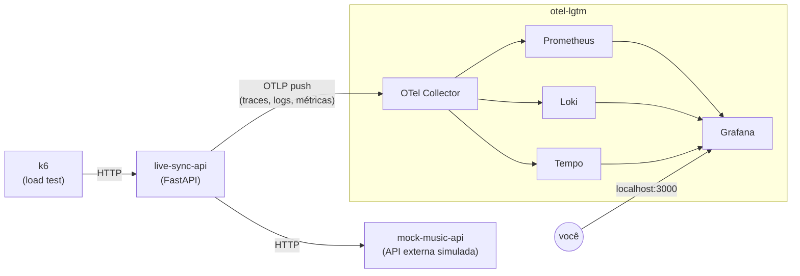

# Mainstage Live Sync API

Solução do Desafio Técnico de Observabilidade B3 — Cenário 1 ("Mainstage Live Sync"). API em FastAPI instrumentada com OpenTelemetry (traces, métricas e logs), com stack completa de observabilidade via `grafana/otel-lgtm` e teste de carga via `grafana/k6`, tudo orquestrado em um único `docker-compose.yaml`.

## Sumário

- [Visão geral da arquitetura](#visão-geral-da-arquitetura)
- [Como rodar](#como-rodar)
- [Endpoints da API](#endpoints-da-api)
- [Observabilidade](#observabilidade)
- [Dashboard do Grafana](#dashboard-do-grafana)
- [Resiliência](#resiliência)
- [Teste de carga (k6)](#teste-de-carga-k6)
- [Estrutura do projeto](#estrutura-do-projeto)

## Visão geral da arquitetura



- **`live-sync-api`**: aplicação do desafio, instrumentada com OpenTelemetry.
- **`mock-music-api`**: simula a API externa de streaming — latência variável e falha aleatória (~5%), pra exercitar a resiliência da API principal.
- **`otel-lgtm`**: imagem oficial da Grafana com OTel Collector, Prometheus, Loki, Tempo e Grafana em um único container.
- **`k6`**: gera tráfego de carga pra popular os dashboards.

## Como rodar

Pré-requisitos: Docker e Docker Compose.

```bash
docker compose up -d --build
```

Isso sobe `live-sync-api`, `mock-music-api` e `otel-lgtm`, além de disparar uma execução do `k6` (5 minutos de carga) contra a API.

| Serviço | URL |
| :--- | :--- |
| API (Mainstage Live Sync) | http://localhost:8000 |
| Mock Music API | http://localhost:9000 |
| Grafana | http://localhost:3000 (login padrão: `admin` / `admin`) |
| Métricas via Collector (pull) | http://localhost:8889/metrics |

Para derrubar tudo:

```bash
docker compose down
```

## Endpoints da API

### `GET /live-sync/track?artist={artist}&title={title}`

Endpoint principal do desafio. Consulta a `mock-music-api` (API externa simulada) e devolve os metadados da faixa, incluindo o tempo de sincronização.

```bash
curl "http://localhost:8000/live-sync/track?artist=Foo%20Fighters&title=Everlong"
```

```json
{
  "track": "Everlong",
  "artist": "Foo Fighters",
  "bpm": 158,
  "energy_level": "High",
  "visual_preset": "strobes_and_lasers",
  "sync_delay_ms": 12
}
```

### `GET /health`

Health check simples.

```bash
curl "http://localhost:8000/health"
```

```json
{"status": "ok"}
```

### `GET /metrics`

Expõe as métricas da aplicação em formato Prometheus.

```bash
curl "http://localhost:8000/metrics"
```

```
# HELP http_server_request_duration_seconds Duration of HTTP server requests.
# TYPE http_server_request_duration_seconds histogram
http_server_request_duration_seconds_bucket{http_request_method="GET",http_response_status_code="200",http_route="/live-sync/track",...,le="+Inf"} 42
http_server_request_duration_seconds_sum{http_request_method="GET",http_response_status_code="200",http_route="/live-sync/track",...} 3.192
http_server_request_duration_seconds_count{http_request_method="GET",http_response_status_code="200",http_route="/live-sync/track",...} 42
# HELP http_server_active_requests ...
http_server_active_requests{...} 0
```

(saída real é bem mais longa — resumida aqui só pra mostrar o formato; os labels completos incluem `job`, `instance`, `otel_scope_name`, etc.)

## Observabilidade

### Traces

Grafana → **Explore** → datasource **Tempo**. Dá pra buscar por `service.name = live-sync-api`, ou ir direto de um log/métrica até o trace correspondente (ver correlação abaixo). Cada trace mostra a requisição completa, incluindo a chamada HTTP para a `mock-music-api`.

### Logs

Grafana → **Explore** → datasource **Loki** → modo **Code** → query:

```
{service_name="live-sync-api"}
```

Os logs são estruturados em JSON e incluem `trace_id`/`span_id` de cada requisição. Expandindo um log (**Details**), a seção **Links** mostra o `trace_id` como link clicável — clicar nele abre o trace completo no Tempo, fechando a correlação log → trace.

### Métricas

Métricas RED (Rate, Errors, Duration) são geradas automaticamente pela instrumentação do FastAPI. Principais séries: `http_server_request_duration_seconds` (histograma) e `http_server_active_requests` (gauge).

Consulta no Prometheus (embutido no Grafana, datasource **Prometheus**):

```promql
histogram_quantile(0.95, rate(http_server_request_duration_seconds[5m]))
```

## Dashboard do Grafana

O arquivo [`dashboard.json`](dashboard.json) na raiz do projeto contém o dashboard usado na entrega, com 9 painéis: um texto de abertura contextualizando a API, 4 cards de resumo rápido (request rate, taxa de erro, latência p95, requisições ativas) e os gráficos de série temporal (RPS por status code, taxa de erro, latência p50/p95/p99) + heatmap de distribuição da latência — cada um com descrição explicando a query por trás.

Para importá-lo: **Dashboards → New → Import → Upload JSON file**, selecionando o datasource Prometheus quando solicitado.

## Resiliência

- A chamada da API para a `mock-music-api` tem **timeout de 2s**; se estourar ou a API externa responder com erro, a aplicação captura a exceção e devolve **HTTP 503** (em vez de quebrar).
- A `mock-music-api` simula instabilidade de rede real: falha aleatoriamente ~5% das requisições e tem latência proporcional à carga simultânea (jitter de rede + atraso por carga).

### Testando a resiliência na prática

Como a falha da `mock-music-api` é probabilística (~5%), rodar algumas requisições em sequência eventualmente aciona o caminho de erro:

```bash
for i in $(seq 1 30); do
  curl -s -o /dev/null -w "%{http_code}\n" "http://localhost:8000/live-sync/track?artist=Test&title=Resilience$i"
done
```

Entre os `200`, deve aparecer algum `503`. Quando isso acontece:
- O log da `live-sync-api` registra `external streaming API failed ... error=...` em nível `ERROR`, com `trace_id` correlacionado.
- O trace no Tempo mostra o span da chamada HTTP pra `mock-music-api` marcado como erro.
- O painel **Errors** do dashboard reflete o aumento na taxa de erro na mesma janela de tempo.

Pra forçar erro de forma determinística (100% das chamadas), derrube a API externa: `docker compose stop mock-music-api`. A `live-sync-api` continua respondendo (com 503) até você subir a dependência de novo.

## Teste de carga (k6)

O serviço `k6` já roda automaticamente com `docker compose up -d` (uma execução de 5 minutos, 50 usuários virtuais, contra `/live-sync/track`). Para rodar um teste adicional sob demanda, sem precisar derrubar a stack:

```bash
docker compose run --rm k6 run /load.js
```

## Estrutura do projeto

```
.
├── docker-compose.yaml          # orquestração de todos os serviços
├── Dockerfile.live-sync-api     # build da API principal
├── Dockerfile.mock-music-api    # build da API externa simulada
├── live_sync_api/
│   ├── main.py                  # rotas da API (/live-sync/track, /health, /metrics)
│   └── telemetry.py             # setup do SDK OpenTelemetry (traces, logs, métricas)
├── mock_music_api/
│   └── main.py                  # API externa simulada (latência + falhas aleatórias)
├── otel-collector-config.yaml   # pipelines do OTel Collector (mount no otel-lgtm)
├── prometheus.yaml              # config do Prometheus embutido (native histograms, scrape)
├── load.js                      # script de carga do k6
└── dashboard.json               # dashboard do Grafana exportado
```
